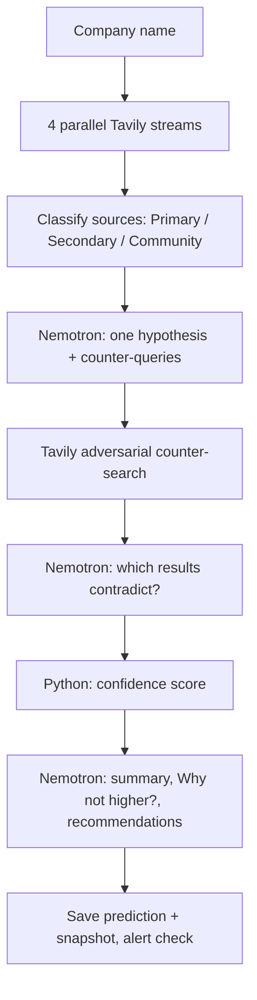

# PulseGrid AI

### Competitive intelligence that argues with itself

PulseGrid AI investigates a company from the live web, forms one hypothesis about its direction, then runs a second search designed to prove that hypothesis wrong. NVIDIA Nemotron does the reasoning, Tavily supplies the evidence, and the confidence score is computed in plain Python from the evidence, not guessed by the model. Every claim links to a real retrieved source, and when a live call fails the app shows the error instead of inventing data.

**Built for the Nebius x NVIDIA Global AI Hackathon 2026**


## Links

- **Live demo:** https://pulsegrid-ai19.streamlit.app
- **Demo video:** https://youtu.be/JKpZhD73PcY
- **Note:** the free Streamlit app may be asleep. Click **"Yes, get this app back up"** and wait about 30 seconds.
- **License:** [MIT](LICENSE) (OSI-approved)

## How we use NVIDIA Nemotron

- **Model:** `nvidia/nemotron-3-super-120b-a12b` (`DEFAULT_MODEL` in [config.py](config.py); override with `NEBIUS_MODEL`).
- **Why Nemotron 3 Super 120B:**
  - Multi-step reasoning: it has to turn numbered evidence into a hypothesis, then judge a second set of results against it.
  - Instruction following: strict JSON output, evidence-ID citations, and treating web text as data.
  - About 12B active parameters (mixture of experts), which keeps latency reasonable for an interactive app.
- **Three calls per investigation** ([ai_engine.py](ai_engine.py)):
  1. **Hypothesis:** reads the numbered evidence (E1, E2, ...) and returns one hypothesis, the supporting evidence IDs, and counter-queries meant to disprove it.
  2. **Contradiction judging:** reads the adversarial results (A1, A2, ...) and returns which ones genuinely contradict the hypothesis, plus an alternative explanation.
  3. **Narrative and actions:** given the already-computed score, writes the executive summary, "Why not higher?" and the recommendations.
- **JSON mode:** every call uses `response_format={"type": "json_object"}`. Output is schema-checked, with one retry if it is invalid.
- **Evidence-ID citing:** the model cites IDs only and never writes URLs. Python maps IDs back to the retrieved Tavily results, and unknown IDs are dropped.
- **Scores computed in Python:** the model sees the final score but is told not to change it.
- On rescans of a company that has pending predictions, Nemotron is also asked to suggest whether new evidence resolves an earlier prediction (the suggestion is only applied if you accept it).

## Where Nebius Token Factory accelerated our workflow

- **OpenAI-compatible API:** we use the standard `openai` client. Only the base URL (`https://api.tokenfactory.us-central1.nebius.com/v1/`) and the API key changed, so there was no custom SDK to learn.
- **No GPU provisioning or model hosting:** Nemotron 3 Super 120B is available as a hosted endpoint, so we went from an API key to working calls without standing up inference ourselves.
- **`/models` endpoint:** [check_models.py](check_models.py) lists the models your key can use and prints the Nemotron IDs, which is how we found the correct model ID.
- **One key, every environment:** the same `NEBIUS_API_KEY` works locally, on Streamlit Community Cloud, and in the daily GitHub Action.

## How we use Tavily

Two kinds of searches per investigation ([search_engine.py](search_engine.py), [ai_engine.py](ai_engine.py)):

1. **Discovery:** 4 parallel `advanced` searches: talent and hiring, product and pricing, customer friction, market and news. Each result is classified Primary, Secondary or Community by domain.
2. **Adversarial counter-search:** Nemotron writes up to 2 counter-queries, which run in parallel through Tavily to look for evidence against the hypothesis.

## What it does



**Screens** ([app.py](app.py)): Investigate, Thinking (live progress), Results, Actions. Two pages sit in the top nav:

- **Investigate:** enter a company name (max 60 characters, 5 investigations per session).
- **Thinking:** six stages with a live activity log: search the live web, sort evidence, form hypothesis, challenge hypothesis, verdict, save and alert.
- **Results:** hypothesis (labelled as a hypothesis, not fact), supporting and contradicting evidence, "Why not higher?", and tabs for the score breakdown, self-challenge log, what changed since the last scan, all sources, and how it ran.
- **Actions:** recommended actions tied to the evidence they respond to, a log of what was saved, watch/unwatch, and a Markdown report download.
- **Watchlist:** watched companies, manual rescan, test alert. A daily GitHub Action ([watch.yml](.github/workflows/watch.yml)) also rescans them. Alerts fire on rescans, not in real time.
- **Track record:** every live investigation is saved as a prediction. Outcomes are recorded only when you accept a suggestion or enter one. Confidence is adjusted by at most +/-10 points, and only once a pattern and industry group has at least 5 resolved predictions.

**Confidence score** (Python, shown factor by factor in the UI): weighted support vs contradiction 35%, amount of supporting evidence 20%, source quality 20%, recency 15%, coverage across the 4 streams 10%. The maximum is 95, and it is capped at 60 if the adversarial search returns nothing.

## Trust and safety

- **Evidence-ID mapping:** URLs come only from retrieved Tavily results, never from model output.
- **Python scoring:** the confidence number is deterministic and auditable.
- **Prompt-injection delimiters:** web text is wrapped in `<web_content>` tags, tag-closing text is stripped, and the system prompt tells the model to treat it as untrusted data.
- **HTML escaping:** web and model text is escaped before rendering, and only `http`/`https` links are rendered as links.
- **No silent fake data:** failed calls show an error. Fake data appears only with `DEMO_SIMULATION=true`, under a red SIMULATED banner.
- **Key redaction:** configured keys are stripped from error messages before they are shown.
- **Supabase RLS:** row-level security is enabled on `predictions`, `watchlist` and `alert_log` with no public policies, so only the server-side service_role key can access them.

## Setup

Requires Python 3.11+, a [Tavily](https://tavily.com) key and a [Nebius Token Factory](https://tokenfactory.nebius.com) key. Supabase is optional.

```bash
git clone https://github.com/Bhoomirathi28/Pulsegrid-ai.git
cd Pulsegrid-ai
pip install -r requirements.txt
cp .env.example .env        # Windows: copy .env.example .env
```

Fill in `.env`. Every variable the app reads:

| Variable | Required | Purpose |
|---|---|---|
| `TAVILY_API_KEY` | yes | Live web search |
| `NEBIUS_API_KEY` | yes | Nemotron on Nebius Token Factory |
| `NEBIUS_MODEL` | no | Defaults to `nvidia/nemotron-3-super-120b-a12b` |
| `SUPABASE_URL`, `SUPABASE_KEY` | no | Persistent storage (service_role key; server-side only). Without it, data goes to local JSON files. |
| `SLACK_WEBHOOK_URL` | no | Slack alerts |
| `APP_URL` | no | Link included in alerts |
| `SMTP_HOST`, `SMTP_PORT`, `SMTP_USER`, `SMTP_PASSWORD`, `ALERT_EMAIL_TO` | no | Email alerts |
| `DEMO_SIMULATION` | no | `true` shows fake data under a red banner. Leave unset for live mode. |

Then:

```bash
python check_models.py      # confirm the model ID your key can use
streamlit run app.py        # open http://localhost:8501
python test_logic.py        # offline tests
```

**Supabase (optional):** in the SQL editor run [supabase_schema.sql](supabase_schema.sql) (creates `predictions`, `watchlist`, `alert_log`). That file does not create `scan_cache`, which is used for snapshot diffing, so also run:

```sql
create table if not exists scan_cache (
    id bigint generated always as identity primary key,
    company_slug text not null unique,
    company_name text not null,
    raw_streams jsonb not null,
    created_at timestamp with time zone default timezone('utc'::text, now()) not null
);
alter table scan_cache enable row level security;
```

## Deploy on Streamlit Community Cloud

1. Push the repo to GitHub.
2. On [share.streamlit.io](https://share.streamlit.io), create an app pointing at `app.py`.
3. In **App settings, Secrets**, add (placeholders shown; see [.streamlit/secrets.toml.example](.streamlit/secrets.toml.example)):

```toml
TAVILY_API_KEY = "your-tavily-key"
NEBIUS_API_KEY = "your-nebius-key"
NEBIUS_MODEL = "nvidia/nemotron-3-super-120b-a12b"
SUPABASE_URL = "https://your-project.supabase.co"
SUPABASE_KEY = "your-supabase-service-role-key"
# optional alerts
SLACK_WEBHOOK_URL = "your-slack-webhook-url"
APP_URL = "https://your-app.streamlit.app"
```

**Optional daily rescan:** add the same values as GitHub repository secrets (`TAVILY_API_KEY`, `NEBIUS_API_KEY`, `NEBIUS_MODEL`, `SUPABASE_URL`, `SUPABASE_KEY`, `SLACK_WEBHOOK_URL`, `APP_URL`, and optionally the `SMTP_*` and `ALERT_EMAIL_TO` values). [watch.yml](.github/workflows/watch.yml) runs `watch_runner.py` at 03:30 UTC, scans at most 5 companies, and refuses to run without Supabase.

## About the names

Stage and heading names come from **Nyaya**, classical Indian logic, which required arguing against your own position before reaching a verdict. English is the main label in the app; the Sanskrit appears small beside it.

| Term | Meaning | Where it appears |
|---|---|---|
| Guptachar | Secret agent, scout | "Search the live web" stage |
| Pramana | Valid means of knowing (evidence) | "Sort evidence" stage, supporting evidence |
| Anumana | Inference | "Form hypothesis" stage |
| Purva Paksha | The opposing position, argued first | "Challenge hypothesis" stage, self-challenge |
| Nirnaya | Conclusion, verdict | "Verdict" stage, score breakdown |
| Smriti | Memory | Track record page |

## Limitations

- Hypotheses are inferences from public web snippets, not facts.
- Tavily snippets are short and often undated, so the recency factor is often low-information.
- Source type is classified by domain heuristics and can be wrong.
- Change detection compares source URLs only, not page content. The first scan only saves a baseline.
- Alerts fire on rescans (manual or daily), not in real time.
- Companies with common-word names can pull in unrelated results.
- Without Supabase, data lives in local JSON files, which are wiped when Streamlit Community Cloud restarts.

## Team

- Bhoomi Rathi ([@Bhoomirathi28](https://github.com/Bhoomirathi28))
- Shiva Nema ([@Shivanema25](https://github.com/Shivanema25))

## License

Released under the [MIT License](LICENSE).
