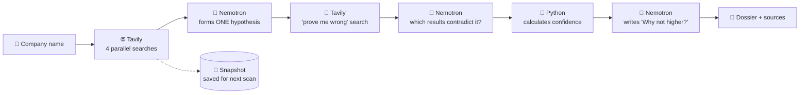

<div align="center">

# ⚡ PulseGrid AI

### The competitive-intelligence agent that tries to prove *itself* wrong


*Built for the Nebius x NVIDIA Global AI Hackathon*

**🔗 Live demo:** `TODO: add Streamlit URL` &nbsp;|&nbsp; **🎬 Video:** `TODO: add YouTube link`

<!-- Replace with a real screenshot: save it as docs/screenshot.png -->


</div>

---

## 🤔 What is it?

Type a company name. PulseGrid searches the live web, forms **one hypothesis** about where that company is heading, then **goes looking for evidence against its own idea**. You get a score that tells you how far to trust it, and **why it isn't higher**.

> Most AI tools give you one confident answer. PulseGrid shows its work and its doubts.

---

## 🧭 How it works



| Step | What happens | Who does it |
|---|---|---|
| 1️⃣ **Investigate** | 4 searches run at the same time: 👥 hiring · 💰 product & pricing · 😤 customer complaints · 📰 market news | Tavily |
| 2️⃣ **Hypothesize** | Reads the numbered evidence, forms one idea marked **HYPOTHESIS — NOT FACT** | Nemotron |
| 3️⃣ **Attack** | Writes search queries designed to *disprove* the idea, then searches for them | Nemotron + Tavily |
| 4️⃣ **Judge** | Decides which of the new results truly contradict the hypothesis | Nemotron |
| 5️⃣ **Score** | Calculates confidence from the evidence. **The AI does not pick the number.** | Python 🧮 |
| 6️⃣ **Explain** | Writes the summary, "Why not higher?" and recommendations | Nemotron |
| 7️⃣ **Remember** | Saves a snapshot. Scan again later to see which sources are new | Supabase / local file |

---

## 🖼️ What you see

```text
┌────────────────────────────────────────────────────────────┐
│ 🟢 LIVE MODE · Model: nvidia/nemotron-3-super-120b-a12b    │
│    Tavily ✅ 4/4 streams + ✅ 2 adversarial · Nebius ✅ 3   │
├────────────────────────────────────────────────────────────┤
│ 🧠 HYPOTHESIS — NOT FACT                                   │
│ "The evidence is consistent with a push into enterprise…"  │
├──────────────────────────────┬─────────────────────────────┤
│ 🟢 SUPPORTING (5)            │ 🔴 CONTRADICTING (1)        │
│ • Primary · 20 infra roles   │ • Community · pricing is    │
│   🔗 careers.example.com     │   unchanged for SMBs        │
│ • Primary · new SLA tier     │   🔗 reddit.com/…           │
│   🔗 docs.example.com        │                             │
├──────────────────────────────┴─────────────────────────────┤
│ 📊 CONFIDENCE  ███████░░░  68% (Moderate)                  │
│    + factor table showing exactly where the points came from│
│ ❓ Why not higher?  (written by Nemotron)                  │
└────────────────────────────────────────────────────────────┘
```

Three tabs: **⚡ Threat Dossier** · **🔍 Changes Since Last Scan** · **🌐 Evidence Ledger** (every raw result with a clickable link).

---

## 🧮 How the confidence score is calculated

The score is plain Python arithmetic over the evidence. You can see every factor in the app.

| Factor | Weight | What it measures |
|---|---:|---|
| ⚖️ Support vs contradiction | 35% | Supporting vs contradicting items, weighted by source quality |
| 📚 Amount of evidence | 20% | More supporting items = higher (full marks at 6) |
| 🏛️ Source quality | 20% | Primary 1.0 · Secondary 0.7 · Community 0.4 |
| 🕒 Recency | 15% | Newer = better. Undated sources count as 0.4 |
| 🌍 Coverage | 10% | How many of the 4 streams back the idea |

- 🔒 The maximum shown is **95%**. Nothing is ever "certain".
- ⚠️ If the "prove me wrong" search finds nothing at all, the score is **capped at 60**, because the idea wasn't really tested.

---

## 🤖 How Nemotron is used

**Model:** `nvidia/nemotron-3-super-120b-a12b` on **Nebius Token Factory** (OpenAI-compatible API).
Run `python check_models.py` to list the model IDs your key can use.

It makes **3 calls** per investigation:

1. 💡 **Hypothesis + counter-queries**: from numbered evidence (E1, E2, …) → one hypothesis, which evidence supports it, and queries to disprove it.
2. ⚔️ **Adversarial judge**: reads the "prove me wrong" results (A1, A2, …) → which ones really contradict it, plus an alternative explanation.
3. ✍️ **Narrative**: given the *already calculated* score → summary, "Why not higher?", recommendations.

**Guardrails**
- The model cites evidence **by ID only**. Python looks up the link from the real Tavily result, so an invented URL can never appear.
- JSON output is cleaned (code fences removed), checked against an expected shape, and retried once if invalid.

## 🔍 How Tavily is used

| Use | What it does |
|---|---|
| 🧭 **Discovery** | 4 parallel `advanced` searches (hiring, product/pricing, complaints, news) → up to 20 sources, each tagged Primary / Secondary / Community |
| 🕵️ **Investigation** | Every retrieved source is listed in the Evidence Ledger with its link |
| ⚔️ **Adversarial search** | Nemotron-written counter-queries search for evidence *against* the hypothesis |

---

## 💾 Change tracking

- **First scan** → "First scan — baseline saved". No changes are claimed.
- **Next scan** → lists sources that are new since the last saved snapshot (matched by URL).
- Stored in **Supabase** if configured, otherwise a local JSON file.
- There is **no background monitoring**. Rescan manually to see what changed.

## 🚨 Honest by design

| Situation | What PulseGrid does |
|---|---|
| An API call fails | Shows the real error. **Never invents data.** |
| `DEMO_SIMULATION=true` | Shows fake data under a huge red **SIMULATED DATA — NOT LIVE** banner |
| Model states a conclusion | Labelled **HYPOTHESIS — NOT FACT**, phrased "consistent with" |

---

## 🚀 Run it yourself

```bash
pip install -r requirements.txt
cp .env.example .env          # then add your keys
python check_models.py        # confirm the Nemotron model ID
python test_logic.py          # offline sanity checks
streamlit run app.py          # open http://localhost:8501
```

<details>
<summary><b>🔑 Keys & configuration</b></summary>

| Variable | Needed | Notes |
|---|---|---|
| `TAVILY_API_KEY` | ✅ | Live web search |
| `NEBIUS_API_KEY` | ✅ | Nebius Token Factory |
| `NEBIUS_MODEL` | optional | Default `nvidia/nemotron-3-super-120b-a12b` |
| `SUPABASE_URL`, `SUPABASE_KEY` | optional | `SUPABASE_KEY` is the **service_role** key. Server-side only, never commit it |
| `DEMO_SIMULATION` | optional | `true` = fake data with red banner |

Keys are read from `st.secrets` first, then environment / `.env`.
For Streamlit Community Cloud, paste the contents of `.streamlit/secrets.toml.example` (with real values) into **App settings → Secrets**.
</details>

<details>
<summary><b>🗄️ Optional Supabase table</b></summary>

```sql
create table if not exists scan_cache (
    id bigint generated always as identity primary key,
    company_slug text not null unique,
    company_name text not null,
    raw_streams jsonb not null,
    created_at timestamp with time zone default timezone('utc'::text, now()) not null
);
```
</details>

---

## 📂 Project layout

```text
app.py            🖥️  Streamlit UI, live-mode panel, simulation banner
ai_engine.py      🧠  Nemotron calls, evidence-ID matching, Python confidence score
search_engine.py  🌐  Tavily streams, retries, snapshots (Supabase + local), diffing
config.py         ⚙️  Secrets / env, DEMO_SIMULATION flag
check_models.py   📋  Lists available Nemotron model IDs
test_logic.py     ✅  Offline tests
```

## 🛡️ Security notes
- Web text is wrapped in `<web_content>` tags and the model is told it is untrusted data, not instructions.
- Everything shown is HTML-escaped; only `http`/`https` links are clickable.
- Company input is validated (max 60 chars), and each session is limited to 5 investigations.
- Error messages are stripped of API keys.

## ⚠️ Limitations
- Hypotheses are inferences from public web snippets, **not facts**.
- Snippets are short and often undated, so the recency factor is rough.
- Source type is guessed from the domain and can be wrong.
- Change detection compares **source URLs only**, not page content.
- Companies with common-word names can pull in unrelated results.
- Without Supabase, snapshots live in a local file, which resets on Streamlit Cloud.

## 📜 License
[MIT](LICENSE) © 2026 Bhoomi Rathi
